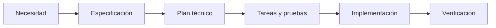

# Constitución de DevGuardian Frontend

**Versión:** 1.1.0 | **Adopción local:** 2026-10-28 | **Estado:** base inicial para revisión del equipo Six seven.

## Principios

### I. Especificar antes de implementar
Toda funcionalidad nueva define historias, requisitos identificables, criterios de aceptación, límites y evidencia de pruebas antes de cambiar comportamiento. Las decisiones pendientes se registran explícitamente. Esta adopción no acredita retrospectivamente desarrollo SDD de funciones anteriores.

### II. Contratos y modularidad
Respetar componentes React, hooks, cliente API y contratos validados. La UI consume evidencia del backend y no simula resultados, tiempos, pruebas ni progreso. El frontend no accede directamente a PostgreSQL.

### III. Seguridad y evidencia
No incluir secretos, URLs de conexión con credenciales ni archivos .env. Mantener guardrails, validación de rutas, aislamiento Git y límites de ejecución. Importar un repositorio no autoriza instalar o ejecutar código externo sin aislamiento. Una operación bloqueada debe explicar el motivo.

### IV. Calidad verificable
Ejecutar npm run check y las pruebas pertinentes antes de cerrar cambios de código; npm run build verifica la entrega. Los cambios documentales pasan npm run sdd:check. Registrar comandos y resultados reales, sin fijar conteos históricos como garantía actual.

### V. Documentación portable
Documentar en español y con enlaces Markdown relativos. Todos los diagramas nuevos deben ser Mermaid nativo: arquitectura con flowchart, interacción con sequenceDiagram, datos con erDiagram y estados con stateDiagram-v2. No depender de plugins ni de exportaciones de imágenes. Mantener explicaciones, restricciones y evidencias junto al diagrama.

## Gobernanza

La constitución orienta los planes del repositorio y no reemplaza autorizaciones del usuario. Modificar principios exige registrar versión, fecha, motivo e impacto en plantillas. El equipo revisa cambios mediante su flujo Git habitual; esta inicialización no crea commits, ramas ni despliegues. La fuente operativa está en .specify/memory/constitution.md y su copia visible se regenera en specs/constitution.md.

## Ciclo de trabajo

## Arquitectura objetivo solicitada

Cambio 1.1.0 del 2026-10-28: documentar microservicios con datos relacionales PostgreSQL privados y multitenant por servicio; SOLID y patrones con evidencia; Shell y microfrontends independientes. El diseño canónico está en el backend, specs/segundo-cerebro/arquitectura-objetivo/. La implementación actual se conserva hasta ejecutar una migración explícita. No usar bases compartidas entre servicios, SQL entre dominios o contexto tenant del navegador como autoridad. El cambio documental no acredita implementación.
