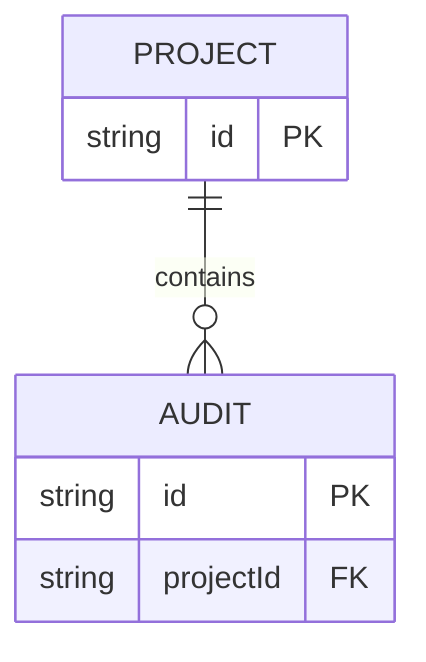

# Modelo de datos

Describir campos, restricciones y cardinalidades según contratos o esquema real. Este ejemplo es conceptual; sustituirlo sin inventar persistencia.

## Documentación visual obligatoria (DevGuardian)

Redactar en español. Representar todos los diagramas de arquitectura, modelos de datos y flujos en bloques independientes de código Mermaid, delimitados por tres backticks y el identificador mermaid en minúsculas. Mantener el bloque al nivel raíz, sin sangría, sin envolverlo en otro bloque ni en HTML. Usar flowchart, sequenceDiagram, erDiagram o stateDiagram-v2; IDs ASCII y etiquetas descriptivas entre comillas para flowchart. No usar imágenes, diagramas ASCII, PlantUML, plugins, JavaScript, enlaces click ni directivas init. Los comandos y ejemplos JSON sí conservan su lenguaje propio.

Guardar los documentos de cada funcionalidad en specs/NNN-nombre/ y enlazarlos con rutas Markdown relativas. Arquitectura en architecture.md, entidades y cardinalidades en data-model.md, secuencias y estados en processes.md. Si no hay persistencia propia, explicarlo y representar solo las entidades lógicas reales; no inventar tablas. Indicar estado actual frente a propuestas.

Consultar specs/README.md y specs/constitution.md. Después de cambiar plantillas o constitución, ejecutar npm run sdd:sync y npm run sdd:check para mantener las copias visibles de Obsidian.
