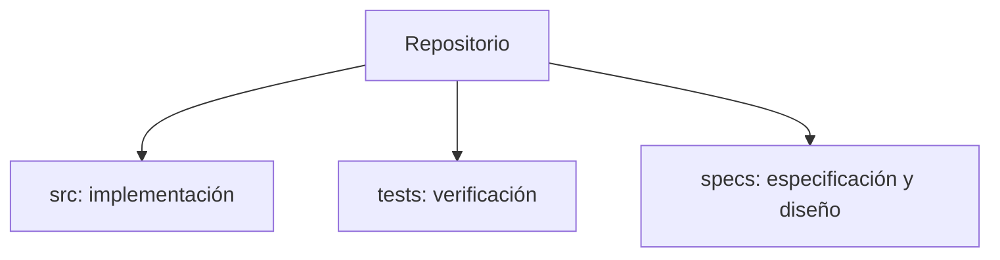
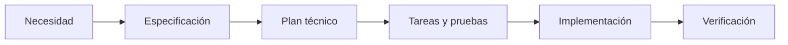

# Implementation Plan: [FEATURE]

**Branch**: `[###-feature-name]` | **Date**: [DATE] | **Spec**: [link]

**Input**: Feature specification from `/specs/[###-feature-name]/spec.md`

**Note**: This template is filled in by the `/speckit-plan` command. See `.specify/templates/plan-template.md` for the execution workflow.

## Summary

[Extract from feature spec: primary requirement + technical approach from research]

## Technical Context

<!--
  ACTION REQUIRED: Replace the content in this section with the technical details
  for the project. The structure here is presented in advisory capacity to guide
  the iteration process.
-->

**Language/Version**: [e.g., Python 3.11, Swift 5.9, Rust 1.75 or NEEDS CLARIFICATION]

**Primary Dependencies**: [e.g., FastAPI, UIKit, LLVM or NEEDS CLARIFICATION]

**Storage**: [if applicable, e.g., PostgreSQL, CoreData, files or N/A]

**Testing**: [e.g., pytest, XCTest, cargo test or NEEDS CLARIFICATION]

**Target Platform**: [e.g., Linux server, iOS 15+, WASM or NEEDS CLARIFICATION]

**Project Type**: [e.g., library/cli/web-service/mobile-app/compiler/desktop-app or NEEDS CLARIFICATION]

**Performance Goals**: [domain-specific, e.g., 1000 req/s, 10k lines/sec, 60 fps or NEEDS CLARIFICATION]

**Constraints**: [domain-specific, e.g., <200ms p95, <100MB memory, offline-capable or NEEDS CLARIFICATION]

**Scale/Scope**: [domain-specific, e.g., 10k users, 1M LOC, 50 screens or NEEDS CLARIFICATION]

## Constitution Check

*GATE: Must pass before Phase 0 research. Re-check after Phase 1 design.*

[Gates determined based on constitution file]

## Project Structure

### Documentation (this feature)

### Source Code (repository root)
<!--
  ACTION REQUIRED: Replace the placeholder tree below with the concrete layout
  for this feature. Delete unused options and expand the chosen structure with
  real paths (e.g., apps/admin, packages/something). The delivered plan must
  not include Option labels.
-->

**Structure Decision**: [Document the selected structure and reference the real
directories captured above]

## Complexity Tracking

> **Fill ONLY if Constitution Check has violations that must be justified**

| Violation | Why Needed | Simpler Alternative Rejected Because |
|-----------|------------|-------------------------------------|
| [e.g., 4th project] | [current need] | [why 3 projects insufficient] |
| [e.g., Repository pattern] | [specific problem] | [why direct DB access insufficient] |

## Documentación visual obligatoria (DevGuardian)

Redactar en español. Representar todos los diagramas de arquitectura, modelos de datos y flujos en bloques independientes de código Mermaid, delimitados por tres backticks y el identificador mermaid en minúsculas. Mantener el bloque al nivel raíz, sin sangría, sin envolverlo en otro bloque ni en HTML. Usar flowchart, sequenceDiagram, erDiagram o stateDiagram-v2; IDs ASCII y etiquetas descriptivas entre comillas para flowchart. No usar imágenes, diagramas ASCII, PlantUML, plugins, JavaScript, enlaces click ni directivas init. Los comandos y ejemplos JSON sí conservan su lenguaje propio.

Guardar los documentos de cada funcionalidad en specs/NNN-nombre/ y enlazarlos con rutas Markdown relativas. Arquitectura en architecture.md, entidades y cardinalidades en data-model.md, secuencias y estados en processes.md. Si no hay persistencia propia, explicarlo y representar solo las entidades lógicas reales; no inventar tablas. Indicar estado actual frente a propuestas.

Consultar specs/README.md y specs/constitution.md. Después de cambiar plantillas o constitución, ejecutar npm run sdd:sync y npm run sdd:check para mantener las copias visibles de Obsidian.

## Arquitectura y flujo

Adaptar este esquema al cambio real; documentar también datos y estados en los archivos enlazados.

