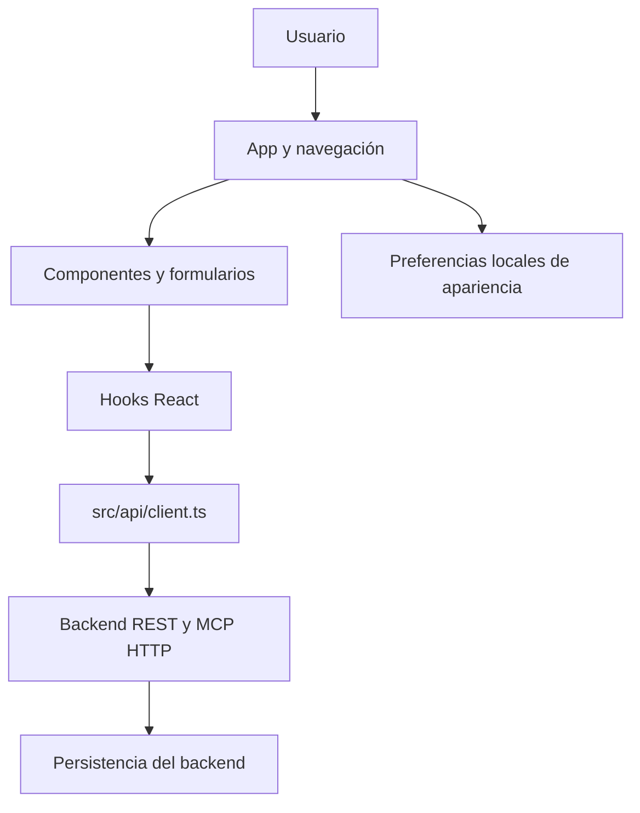

# Arquitectura actual

El navegador consume la API pública; no abre rutas del sistema ni conecta con PostgreSQL. Los hooks React gestionan estado de UI y no equivalen a los hooks de seguridad del backend.

