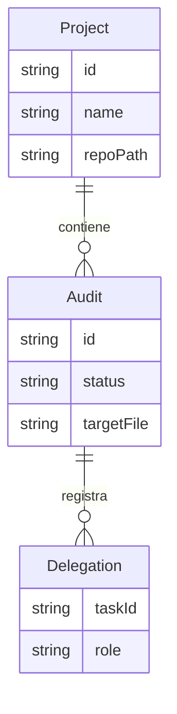

# Modelo de datos actual

Modelo lógico de datos consumidos por HTTP, no tablas ni persistencia propia del navegador. Los contratos reales están en src/types/contracts.ts. La preferencia devguardian.theme es independiente de los registros del servidor; no guarda tokens.

