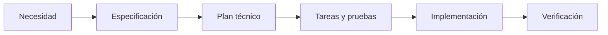

# Plan técnico: adopción SDD

**Repositorio:** Frontend | **Fecha:** 2026-10-28 | **Especificación:** [spec.md](spec.md).

## Contexto técnico

React, TypeScript estricto, Vite, Zod y Vitest. El cliente HTTP está en src/api/client.ts. La base de datos pertenece al backend; localStorage guarda preferencias de UI, no credenciales.

## Comprobación constitucional

Especificación previa a futuros cambios; conservación de seguridad y contratos; documentos en español; diagramas Mermaid; validación reproducible sin secretos.

## Ejecución

1. Inicializar con specify init --here --integration codex --script ps --no-git --force (realizado una vez sobre el árbol inspeccionado).
2. Adaptar constitución y plantillas oficiales preservando secciones requeridas.
3. Añadir arquitectura, datos y procesos visibles en specs/.
4. Sincronizar copias y comprobar con los scripts npm de documentación.
5. Actualizar README y revisar git diff sin commit ni push.

## Diseño

- [Arquitectura](architecture.md)
- [Datos](data-model.md)
- [Procesos](processes.md)

## Riesgos

Las carpetas ocultas no se indexan como notas: se usan copias visibles. La reinicialización puede sobrescribir personalizaciones: revisar diff antes de actualizar CLI. El soporte Mermaid depende de la versión de Obsidian: usar sintaxis básica sin extensiones.

## Verificación

Ejecutar npm run sdd:sync y npm run sdd:check. Ejecutar npm run check para comprobar que las habilidades añadidas no alteran las reglas existentes de lint. No ejecutar reparaciones reales para validar documentación.

