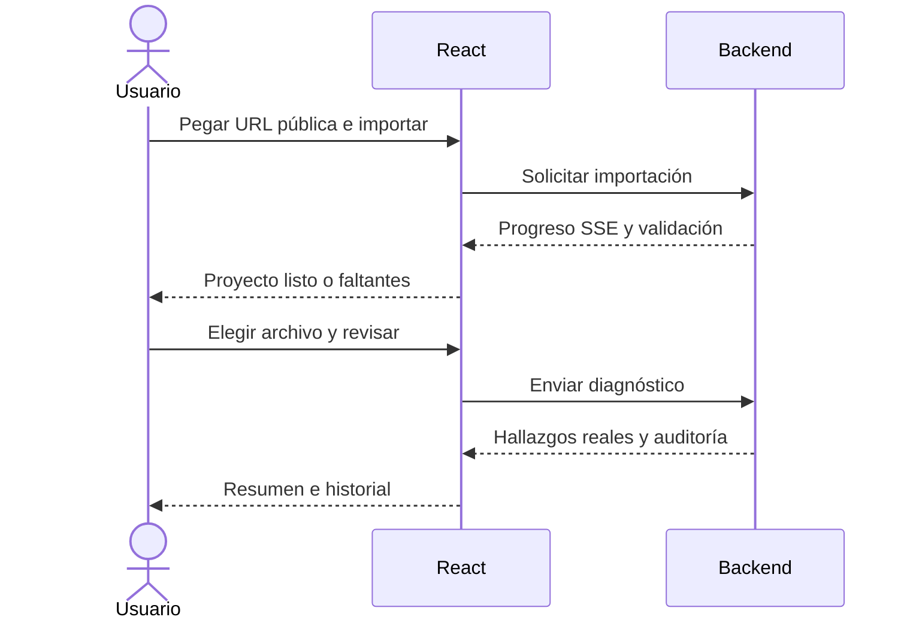

# Procesos actuales

El usuario prepara argumentos mediante formularios; la evidencia proviene del backend. Una selección no dispara herramientas de mutación. Importar un repositorio prepara análisis estático y no implica ejecutar sus dependencias.

