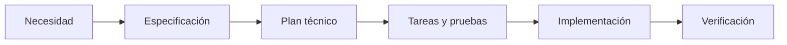

# Especificación: adopción SDD

**Fecha:** 2026-10-28 | **Estado:** configuración local implementada, pendiente de revisión del equipo.

## Objetivo

Incorporar Spec Kit a DevGuardian Frontend sin cambiar la aplicación, el esquema SQL ni el historial Git.

## Historias y aceptación

- **HU-SDD-01 (P1):** Como desarrollador, quiero una constitución y plantillas para especificar antes de implementar. Dado el repositorio, al abrir Codex existen las habilidades de Spec Kit y las fuentes .specify.
- **HU-SDD-02 (P1):** Como revisor, quiero leer diagramas en Obsidian sin plugins. Dada la raíz abierta como bóveda, al leer specs/README.md encuentro arquitectura, datos y procesos con bloques Mermaid independientes.
- **HU-SDD-03 (P2):** Como mantenedor, quiero detectar divergencias entre plantillas operativas y copias visibles. Si modifico una fuente sin sincronizar, sdd:check falla; tras sdd:sync vuelve a pasar.

## Requisitos

- FR-001: conservar módulos, contratos, hooks y archivos existentes.
- FR-002: generar diagramas nuevos en Mermaid nativo con enlaces relativos.
- FR-003: mantener una fuente operativa y copias deterministas.
- FR-004: no incluir secretos ni dependencias nuevas en runtime.
- FR-005: validar documentación sin cambiar ramas ni crear commits.

## Fuera de alcance

No se implementan funciones nuevas, no se migra la base de datos, no se configura una conexión de Obsidian ni se acredita revisión visual automática.

## Recorrido

