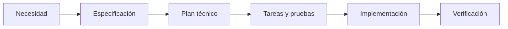

# SDD de DevGuardian Frontend

Abrir la raíz de este repositorio como bóveda en Obsidian y entrar a este índice. Leer los diagramas en **Vista de lectura** o **Live Preview**; en modo Fuente se ve el código. Mermaid es nativo: no instalar plugins, CSS ni configurar .obsidian. Obsidian oculta .specify y .agents; por eso este índice, la constitución y las copias de plantillas están en specs/, una carpeta visible.

- [Constitución](constitution.md)
- [Especificación de adopción SDD](001-sdd-foundation/spec.md)
- [Plan técnico](001-sdd-foundation/plan.md)
- [Arquitectura actual](001-sdd-foundation/architecture.md)
- [Modelo de datos](001-sdd-foundation/data-model.md)
- [Procesos](001-sdd-foundation/processes.md)
- [Tareas y comprobación](001-sdd-foundation/tasks.md)
- [Evidencia de validación](001-sdd-foundation/validation.md)
- [Plantilla de especificación](templates/spec-template.md)
- [Plantilla de plan](templates/plan-template.md)
- [Plantilla de constitución](templates/constitution-template.md)

## Apertura en Obsidian

El 2026-10-28 se añadió esta carpeta original como bóveda local de Obsidian, sin copiar los Markdown. En Obsidian 1.14.5 aparece una solicitud de confianza al abrir el primer diagrama: **Display Mermaid diagrams in this vault?**. El usuario debe pulsar **Allow** para autorizar la visualización en cada bóveda. Es un permiso nativo de la aplicación; no requiere plugins ni editar configuración. La revisión del render permanece pendiente hasta aceptar ese permiso.

## Uso

Inicializado con Specify CLI 0.8.9, integración Codex y scripts PowerShell. En una nueva sesión de Codex abierta en este repositorio usar las habilidades instaladas: $speckit-constitution, $speckit-specify, $speckit-plan, $speckit-tasks y $speckit-implement. Los nombres exactos y el flujo provienen de .agents/skills/. Las demás integraciones se configuran por separado.

Para nuevas funcionalidades, crear specs/NNN-nombre/ con spec.md, plan.md, architecture.md, data-model.md y processes.md; copiar y adaptar las plantillas cuando haga falta. No volver a ejecutar setup-plan sobre un plan final: copia la plantilla sobrescribiéndolo. No ejecutar specify init --force rutinariamente: podría restaurar plantillas personalizadas.

La documentación original de módulos se conserva; esta regla Mermaid aplica a nuevos documentos y a revisiones futuras, sin convertir en bloque todos los README históricos.

## Fuentes y copias

.specify/templates/ y .specify/memory/constitution.md son las fuentes operativas. specs/templates/ y specs/constitution.md son copias de lectura, no editarlas directamente. Después de cambios de fuentes ejecutar:

```powershell
npm run sdd:sync
npm run sdd:check
```

La comprobación verifica igualdad de copias, cercas de código y política Mermaid; no sustituye la revisión visual de los diagramas. Los .md son portables a GitHub y Obsidian. Ignorar .obsidian/ evita publicar preferencias personales; no se genera configuración de Obsidian.

## Fuentes oficiales

- [Spec Kit: comandos](https://github.github.com/spec-kit/reference/core.html)
- [Obsidian: diagramas Mermaid nativos](https://help.obsidian.md/Editing+and+formatting/Advanced+formatting+syntax)

## Flujo SDD


